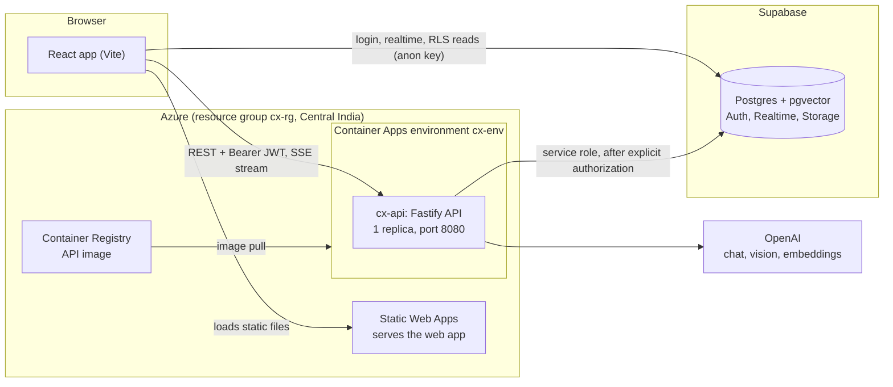
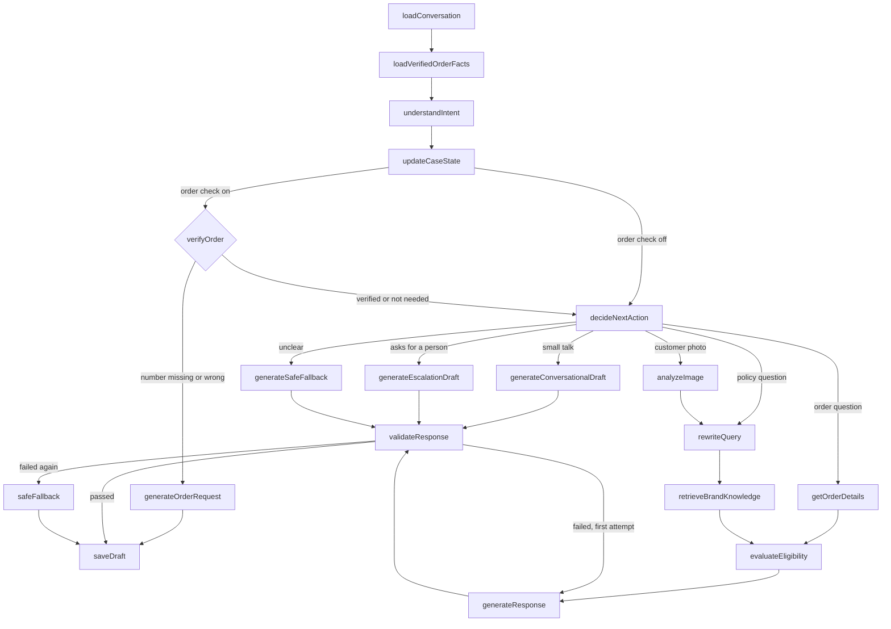

# Architecture

AI-powered CX Reply Assistant: agents manage customer conversations and get **draft-only**, brand-grounded AI replies
that they edit, approve and send. The AI never sends anything itself.

## 1. System overview

- **Browser → Supabase** (anon key): sign-in, realtime updates, and read-only queries that row-level security (RLS)
  restricts to the user's brands.
- **Browser → API** (REST with the user's JWT): every write and every AI action. Drafts stream back as server-sent events.
- **API → Supabase**: the API verifies the JWT, loads the user's role and brands from the database, authorizes the
  request explicitly, and then reads and writes with the service-role client. RLS is the second layer for anything the
  browser queries directly.
- **API → OpenAI**: chat model for understanding and writing, a vision model for customer photos, embeddings for search.

No Redis, queue or other infrastructure. Rate limiting is in-process (`@fastify/rate-limit` plus per-agent and
per-conversation limits for AI calls), so the API runs as **one replica**; this is a documented trade-off.

## 2. Version decisions (verified against npm on 2026-10-23)

| Package               | Version                                                                    | Note                                                                                        |
| --------------------- | -------------------------------------------------------------------------- | ------------------------------------------------------------------------------------------- |
| Node                  | 24 LTS (>=22)                                                              | The container image uses `node:24-slim`.                                                    |
| TypeScript            | **5.9.3**                                                                  | Latest is 7.x, but `typescript-eslint` 8.72 supports `<6.1`. Pinned for lint compatibility. |
| React / Vite          | 19.x / 8.x                                                                 |                                                                                             |
| Tailwind              | 4.x (`@tailwindcss/vite`)                                                  | shadcn/ui components added by hand (Radix + cva), `components.json` present                 |
| Fastify               | 5.x                                                                        |                                                                                             |
| Zod                   | 4.x                                                                        | shared contracts and LLM structured output                                                  |
| LangChain / LangGraph | `@langchain/core` 1.x, `@langchain/openai` 1.x, `@langchain/langgraph` 1.x |                                                                                             |
| Supabase JS           | 2.x                                                                        |                                                                                             |
| Vitest / Playwright   | 5.x / 1.64                                                                 |                                                                                             |

APIs of LangChain/LangGraph are verified against the installed package typings before use, not recalled from memory.

## 3. Monorepo layout

- `packages/shared`: Zod schemas, inferred types and API contracts (single source of truth for web, API and AI).
- `packages/ai`: pure AI logic: LangChain model factory, prompts, the LangGraph `StateGraph`, tools, deterministic
  policy rules, guardrails, retrieval. No HTTP or framework code. Dependencies (database, model) are injected so tests can
  mock them.
- `apps/api`: Fastify: auth plugin, routes, services (the only code that talks to Supabase).
- `apps/web`: React UI. Never holds secrets; talks to the API and to Supabase (anon key and RLS).
- `supabase/`: migrations and seed data. See [database.md](database.md).
- `scripts/`: migrate, seed, embedding backfill, retrieval calibration, evaluation runners, Azure build and deploy scripts.
- `tests/`: integration tests and Playwright end-to-end tests.

Layering inside the API: `routes → services → Supabase`. Business rules live in `packages/ai/src/policy` (pure
functions) and are reused by the tools and the guardrails, so nothing is duplicated.

### API surface

Everything under `/api` requires a bearer token; `/health` and `/ready` are public.

| Area               | Endpoints                                                                                                                                                                       |
| ------------------ | ------------------------------------------------------------------------------------------------------------------------------------------------------------------------------- |
| Service            | `GET /health`, `GET /ready` (database reachable)                                                                                                                                |
| Session and brands | `GET /api/me`, `GET /api/customers`, `GET /api/brands`, `GET /api/brands/:id`, `PATCH /api/brands/:id/settings` (admin)                                                         |
| Conversations      | list, create, get, `PATCH` (open/close), `GET …/order`, `GET …/customer-orders`, messages (send, unsend), attachments (upload), read receipts                                   |
| AI drafts          | `POST /api/ai/generate`, `/regenerate`, and the streaming `…/stream` versions; `GET /api/conversations/:id/draft`; `GET/PATCH /api/ai/drafts/:id`; `approve`, `send`, `discard` |
| AI logs            | `GET /api/ai/logs`, `GET /api/ai/logs/:id`                                                                                                                                      |
| Knowledge base     | list, get, versions, create, update, archive (`DELETE`), `restore`, re-embed, retrieval preview (admin for changes)                                                             |

### Web app

React Router pages: Login, Dashboard, Conversations (customer list, chat, side panel with customer, orders and the AI
assistant), Knowledge Base, AI Logs, Settings. Server state is cached with TanStack Query and refreshed by Supabase
Realtime events on `messages` and `ai_generations`.

### Models and tunable settings

| Use                                    | Default model (setting)                             |
| -------------------------------------- | --------------------------------------------------- |
| Understanding and writing replies      | `gpt-4o-mini` (`OPENAI_CHAT_MODEL`)                 |
| Reading customer photos                | `gpt-4o-mini` (`OPENAI_VISION_MODEL`)               |
| Compliance check of non-English drafts | `gpt-4.1-mini` (`OPENAI_JUDGE_MODEL`)               |
| Search embeddings (1536 dimensions)    | `text-embedding-3-small` (`OPENAI_EMBEDDING_MODEL`) |

Other settings (all in `.env.example`): retrieval thresholds (`RETRIEVAL_*`), AI rate limits per agent and per
conversation (`RATE_LIMIT_AI_*`), the request timeout (`REQUEST_TIMEOUT_MS`), the order check (`ORDER_GATE_*`) and
`LLM_MODE` (`openai`, or `mock` for tests only).

## 4. Security model

1. **Auth**: Supabase Auth JWT. The API verifies it with `supabase.auth.getUser(token)`; profile and role are loaded
   from the database, never from client claims.
2. **Authorization**: `brand_memberships(user_id, brand_id)`; admins have global access. Every route resolves the brand
   from the database row (conversation → brand) and checks membership. Client-supplied brand or user ids are never
   trusted. Another brand's resources return 404.
3. **RLS** is enabled on every table from the first migration. Browser users can only `SELECT`; every mutation goes
   through the API. Composite foreign keys keep child rows in the same brand as their parent.
4. **Brand isolation in SQL**: `match_kb_hybrid(p_brand_id, …)` filters by `brand_id` and `is_active` inside the
   function and checks the caller's brand access itself.
5. **Storage**: private bucket, path `brand/<brand_id>/conversation/<id>/…`, signed URLs only, storage policy keyed on
   brand membership. Uploads are validated by the API (magic bytes, 5 MB, PNG/JPEG/WebP/GIF).
6. **LLM safety**: customer text and policy text are untrusted data (delimited, never instructions). The tools are a
   fixed, read-only registry; none can modify orders or issue refunds. Output is validated in code (see section 6).
7. **Secrets** live only in server-side configuration (Container Apps secrets in production, `.env` locally). The
   browser bundle contains only the Supabase URL, the public anon key and the API address (`VITE_*`).

## 5. Data model (summary)

`profiles, brands, brand_settings, brand_memberships, customers, orders, order_items, conversations, messages,
message_attachments, knowledge_base, knowledge_base_versions, ai_generations, ai_generation_sources, ai_draft_events,
escalation_requests`. Full detail, relationships and migrations: [database.md](database.md).

- `knowledge_base`: `embedding vector(1536)` (text-embedding-3-small), `content_hash`, `version`, `embedding_status`,
  a generated `tsvector` column with a GIN index, and an HNSW index on the embedding.
- Drafts are `ai_generations` rows: `draft → edited → approved → sent`, or `discarded`, `superseded`, `withheld`,
  `failed`. Every transition appends an `ai_draft_events` row. Only one live draft exists per conversation.
- `fn_send_draft` is an atomic, idempotent function (row lock, status check, insert message, mark sent).
  `messages.client_message_id` is unique per conversation, which makes manual and customer sends idempotent.
- **Stale policy**: a draft stores the `(kb_id, version)` of every source. Approve and send compare them with the
  current versions and reject with `STALE_POLICY` when a policy changed.
- `conversations.order_id` is the **verified order** for the chat (see the order check in section 6).

## 6. AI workflow (LangGraph)

A typed `StateGraph`. The graph ends at `saveDraft`; approval and sending are separate API operations.

- **Understanding** is one model call that returns the intent, language, a standalone search query and what the
  customer has stated (the _case state_). `updateCaseState` merges it deterministically with the previous state; the message
  history stays authoritative. See [conversation-intelligence.md](conversation-intelligence.md).
- **Order check** (`verifyOrder`, off by default): when a question needs order data (status, return, refund, exchange,
  damage, missing item, cancellation) and no order is linked, the number must match one of **this customer's** orders
  (deterministic text match, no model involved). A match links the order to the conversation; otherwise a fixed-wording
  draft asks for the number, and after `ORDER_GATE_MAX_ATTEMPTS` wrong numbers the case goes to a person. With the same setting on, a customer
  message that names one of their orders also links (or switches) the order as soon as it arrives.
- **Retrieval**: when nothing relevant is found for a policy question, the draft becomes a handoff to a person written
  from the case alone, so the model never has to invent policy. A policy question the sources do not cover (for example
  "do you ship to Canada?") is answered as "I can't confirm that; the team will follow up".
- **Eligibility** (return, refund, damage, cancellation, free shipping, delivery estimate) is computed by plain
  functions in `packages/ai/src/policy`; the model only phrases the result.
- **Tools**: the workflow calls a fixed registry (`packages/ai/src/tools.ts`) at set points, bound to one conversation.
  No tool takes a brand, customer or user id, and none can change an order. The registry is also exposed as LangChain
  tools (`getConversation`, `getOrderDetails`, `retrieveBrandPolicies`, `checkReturnEligibility`,
  `checkRefundEligibility`, `calculateShippingEligibility`, `calculateDeliveryEstimate`, `analyzeCustomerImage`,
  `requestHumanEscalation`). The only write is recording an escalation request.
- **Retry**: at most two writing attempts (`MAX_COMPOSE_ATTEMPTS = 2`): the first, then one retry that is given the
  violations to fix; after that the safe fallback text is used.
- **Checkpointing**: in-memory (`MemorySaver`) per run for retry recovery. The authoritative history is in Postgres.
- **Languages**: English and Hinglish; the reply follows the customer's language when the brand supports it.

**Guardrail layers**: (1) SQL retrieval isolation and sufficiency, (2) deterministic business rules, (3) prompt
controls, (4) code validation of every draft (`packages/ai/src/guardrails.ts`), (5) one corrective retry, then a safe
fallback. The code checks are:

| Check                                                               | Blocks a draft that…                                                          |
| ------------------------------------------------------------------- | ----------------------------------------------------------------------------- |
| `citations_exist`, `no_policy_without_evidence`                     | cites sources that do not exist, or states policy with no supporting source   |
| `grounded_figures`, `order_number_matches`                          | states a figure or order number that is not in the sources or the order       |
| `no_completed_action_claims`                                        | says a refund, cancellation or dispatch has already happened                  |
| `no_unsupported_promises`, `no_guarantees`, `no_invented_offers`    | promises or guarantees something the rules and policy do not support          |
| `eligibility_claim_supported`, `no_unrequested_eligibility`         | claims eligibility the rules do not confirm, or raises it unasked             |
| `no_invented_procedure`                                             | describes how something is done (label, portal, collection…) without a source |
| `no_unsupported_claim`                                              | states what the brand does or does not offer when no source mentions it       |
| `no_cross_brand_leakage`, `no_internal_details`, `no_source_labels` | names another brand, or exposes ids, system details or internal labels        |
| `photo_consistency`, `no_redundant_question`, `no_repeated_reply`   | mis-describes photos, re-asks a known fact, or repeats the previous reply     |

Blocking failures trigger the retry; warnings stay visible to the agent. A model-based compliance check runs only for
non-English drafts, and its findings must quote the reply verbatim to count.

**Streaming**: `POST /api/ai/generate/stream` (and `/regenerate/stream`) returns server-sent events: `step` (a stage
started), `draft_text` (the reply so far, a preview that is still being validated), `draft_reset` (the preview was
rejected and is being rewritten), then `done` with the saved draft or `error`. The non-streaming endpoints remain.

## 7. Retrieval calibration

Hybrid = vector (cosine) plus full-text (`plainto_tsquery` with the words combined by OR, so a multi-word question can
match any of them and ranking decides relevance), fused with Reciprocal Rank Fusion (k = 60), plus a category
boost from the intent. Relevance uses an absolute similarity threshold and a relative margin. The thresholds are
environment-configurable and were chosen from a labelled dataset (`pnpm calibrate`); results and caveats are in
[retrieval-calibration.md](retrieval-calibration.md).

## 8. Deployment on Azure

| Part             | Azure service                 | Resource                         | Notes                                                                   |
| ---------------- | ----------------------------- | -------------------------------- | ----------------------------------------------------------------------- |
| API              | Container Apps (Consumption)  | `cx-api` in environment `cx-env` | External HTTPS ingress, port 8080, exactly 1 replica, always on         |
| API image        | Container Registry (Basic)    | `cxrohit17acr`                   | Built in Azure from the repo's `Dockerfile`; one tag per release        |
| Web app          | Static Web Apps (Free)        | `cx-web`                         | Static build; `staticwebapp.config.json` rewrites deep links to the app |
| Logs             | Log Analytics workspace       | created with the environment     | `az containerapp logs show -n cx-api -g cx-rg --type console`           |
| All of the above | Resource group, Central India | `cx-rg`                          | `az group delete -n cx-rg` removes everything                           |
| Data and auth    | Supabase (not on Azure)       | your Supabase project            | Postgres, pgvector, Auth, Realtime, private Storage                     |

- **API image**: a two-stage `Dockerfile` (build with pnpm, then a slim runtime image running as a non-root user).
  The workspace packages are bundled into `dist/server.js` by tsup; only third-party runtime dependencies are installed.
- **Configuration**: the Supabase service-role key and the OpenAI key are Container Apps _secrets_; everything else is
  an environment variable. `CORS_ORIGINS` is the web app's address. A changed secret needs a restart of the active
  revision (the deploy script does it).
- **Health**: `/health` (process is up) and `/ready` (database reachable). The embedding sweep that retries failed or
  pending policy embeddings runs inside the API every 10 minutes.
- **Web build**: Vite bakes `VITE_API_URL`, `VITE_SUPABASE_URL` and `VITE_SUPABASE_ANON_KEY` into the bundle, so the
  web app is rebuilt whenever the API address changes.
- **Streaming**: server-sent events pass through the Container Apps ingress; the API disables response buffering headers.
- **Release process**: three scripts in `scripts/`: `azure-build-image.ps1` (clean copy, `az acr build`),
  `azure-deploy-api.ps1` (create or update the container app from `.env`) and `azure-deploy-web.ps1` (build, upload,
  set CORS). Step by step, with troubleshooting: [azure-deployment.md](azure-deployment.md).
- **Local development**: `pnpm dev` runs the API (port 3101) and the web app (port 5173) against a Supabase development
  project and `.env`. CI-style unit tests use a mocked model; real-model evaluation is a separate command.

## 9. External dependencies and known limitations

- **OpenAI** (chat, vision, embeddings) and **Supabase** are required; a mock model exists for tests and trying the UI only.
- **Single API replica**: rate limits and in-flight generation guards are in memory; scaling out needs a shared store.
- **Per-process checkpoints**: a restart loses only an in-flight retry; the saved drafts and audit trail are in Postgres.
- **One Supabase project**: local development and the Azure deployment currently share it, including the demo logins.
  Use a separate project for real production data, and remove or re-password the demo accounts.
- **Synchronous generation** with a request timeout (`REQUEST_TIMEOUT_MS`). The streamed response keeps the connection busy
  for the length of a generation; a job queue would be the next step at scale.
