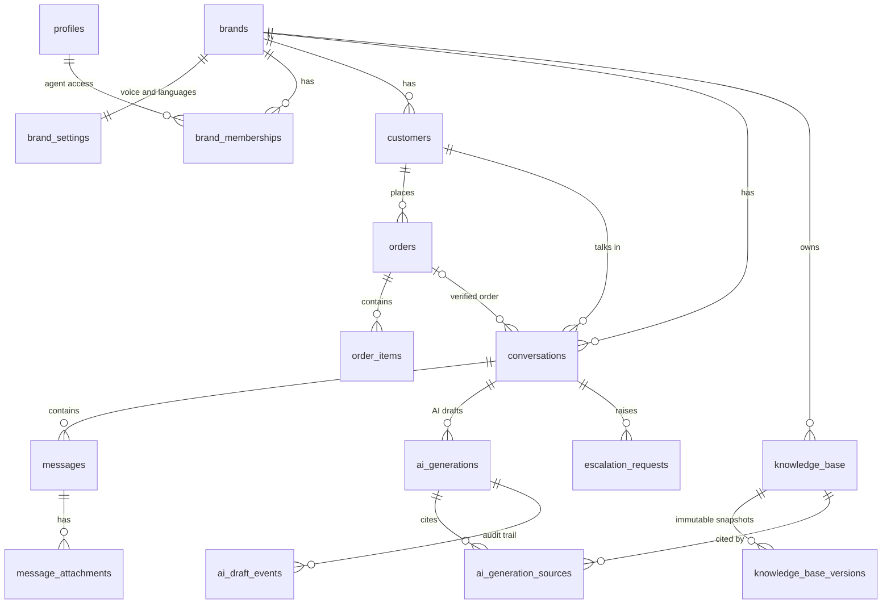

# Database and schema

PostgreSQL on Supabase, with `pgvector` for semantic search and full-text search for keywords. Everything is created by
the SQL files in [`supabase/migrations/`](../supabase/migrations), applied in filename order.

## Entity relationships



## Tables

| Table                     | Purpose                                                                                                                                                                        |
| ------------------------- | ------------------------------------------------------------------------------------------------------------------------------------------------------------------------------ |
| `profiles`                | One row per Supabase Auth user: email, name, `role` (`admin` or `agent`).                                                                                                      |
| `brands`                  | The companies the team supports (for example Bloom Botanics, Nordic Living).                                                                                                   |
| `brand_settings`          | Per-brand voice: tone, communication style, greeting, sign-off, supported languages.                                                                                           |
| `brand_memberships`       | Which agents may access which brands. Admins see every brand.                                                                                                                  |
| `customers`               | A brand's customers (unique email per brand).                                                                                                                                  |
| `orders`, `order_items`   | Order number (unique per brand), status, total, placed/shipped/delivered/estimated dates, line items. The source of truth the AI reads.                                        |
| `conversations`           | One chat with a customer. `order_id` is the order the chat is about (set by the agent, or when the customer gives a matching order number). `status`: open/closed.             |
| `messages`                | Customer, agent and system messages. `client_message_id` makes sending idempotent; `unsent_at` marks a withdrawn message (the row stays as a tombstone).                       |
| `message_attachments`     | Customer photos (PNG/JPEG/WebP/GIF, up to 5 MB) stored in a private bucket.                                                                                                    |
| `knowledge_base`          | Policy entries per brand: title, category, content, optional structured `conditions` (windows, thresholds), `version`, `embedding vector(1536)`, a generated full-text column. |
| `knowledge_base_versions` | Append-only snapshot of every version of a policy entry.                                                                                                                       |
| `ai_generations`          | Every AI run: the draft text and its status, the intent, guardrail results, eligibility results, order facts, the case state, a node-by-node trace, token use and latency.     |
| `ai_generation_sources`   | Which policy entries (and which versions) a draft relied on, with scores.                                                                                                      |
| `ai_draft_events`         | Append-only audit log of every draft transition (created, edited, approved, sent, discarded...).                                                                               |
| `escalation_requests`     | Cases the AI handed to a person, with the reason.                                                                                                                              |

Views: `conversation_list` (inbox: customer, brand, last message, unread count; ignores unsent messages).

## Draft lifecycle

`draft` → `edited` → `approved` → `sent`. A draft can also end as `discarded`, `superseded` (a newer draft replaced it),
`withheld`, or `failed`. Only one live draft exists per conversation. A draft remembers the version of every policy it cited;
if one of those entries changes before sending, approval is rejected as `STALE_POLICY`.

## Key design decisions

- **Brand isolation at every layer.** Row-level security (RLS) is enabled on every table in the first migration. Browser
  users can only `SELECT`; every write goes through the API, which authorizes it and uses the service role. Composite foreign
  keys `(id, brand_id)` make it impossible to link a row to a different brand's conversation, customer or order.
- **Hybrid retrieval inside SQL.** `match_kb_hybrid(p_brand_id, …)` fuses vector (cosine) and full-text rankings with
  Reciprocal Rank Fusion and only ever returns active entries of the given brand. It checks the caller's brand access itself.
- **Atomic draft operations.** `fn_save_generation`, `fn_edit_draft`, `fn_approve_draft`, `fn_send_draft`, `fn_discard_draft`
  lock the draft row. `fn_send_draft` is idempotent: sending twice (or five times concurrently) creates exactly one message.
- **Versioning and embeddings stay consistent.** A trigger computes a content hash and bumps `version` whenever wording,
  activation or archival changes, and writes an immutable snapshot. When the text changes, the old embedding is removed in the
  same statement, so a stale vector can never be searched. `draft_stale_sources(draft_id)` reports which cited entries changed.
- **Append-only audit data.** `knowledge_base_versions` and `ai_draft_events` reject updates and deletes (cascades from a
  deleted parent still work).
- **Private storage.** Attachments live in the `attachments` bucket at `brand/<brand_id>/conversation/<conversation_id>/…`;
  clients get short-lived signed URLs, and the storage policy checks brand membership.
- **Realtime.** `messages` and `ai_generations` are published to Supabase Realtime; RLS applies to each event.

## Migrations

| File                                           | What it adds                                                                   |
| ---------------------------------------------- | ------------------------------------------------------------------------------ |
| `20261023000001_core_schema.sql`               | Extensions, all tables, constraints, indexes, triggers, RLS enabled everywhere |
| `20261023000002_rls_policies.sql`              | Access helper functions, read-only policies, realtime, storage policy          |
| `20261023000003_retrieval_and_draft_rpcs.sql`  | Hybrid search, stale-policy check, save/edit/approve/send/discard functions    |
| `20261023000004_append_only_allow_cascade.sql` | Append-only tables still allow cascade deletes                                 |
| `20261023000005_fix_match_kb_hybrid.sql`       | Keyword search uses OR semantics; brand access enforced inside the function    |
| `20261023000006_conversation_list_view.sql`    | The inbox view                                                                 |
| `20261024000007_case_state.sql`                | `ai_generations.case_state` (what the customer has told us) and its save logic |
| `20261024000008_unsend_messages.sql`           | `messages.unsent_at/unsent_by` and the updated inbox view                      |
| `20261024000009_kb_embedding_lifecycle.sql`    | Drop the old embedding when wording changes or an entry is archived            |
| `20261024000010_kb_embedding_text_only.sql`    | Only text changes invalidate an embedding; figure-only edits keep it           |

## Applying the schema and demo data

```bash
pnpm db:migrate   # applies the migrations in order and records a checksum for each (needs DATABASE_URL)
pnpm db:seed      # demo brands, customers, orders, policies, demo logins (idempotent; see README for the password)
pnpm db:embed     # computes embeddings for policies that need them (skips unchanged ones; --force re-embeds all)
```

The seed creates two brands, eight customers with orders in different states (processing, shipped, in transit,
delivered), 18 policy entries, four demo logins and a few demo conversations.
`pnpm db:clear-chats` deletes all conversations and their messages, drafts and attachments while keeping customers,
orders and policies (dry run unless `--yes` is passed).
